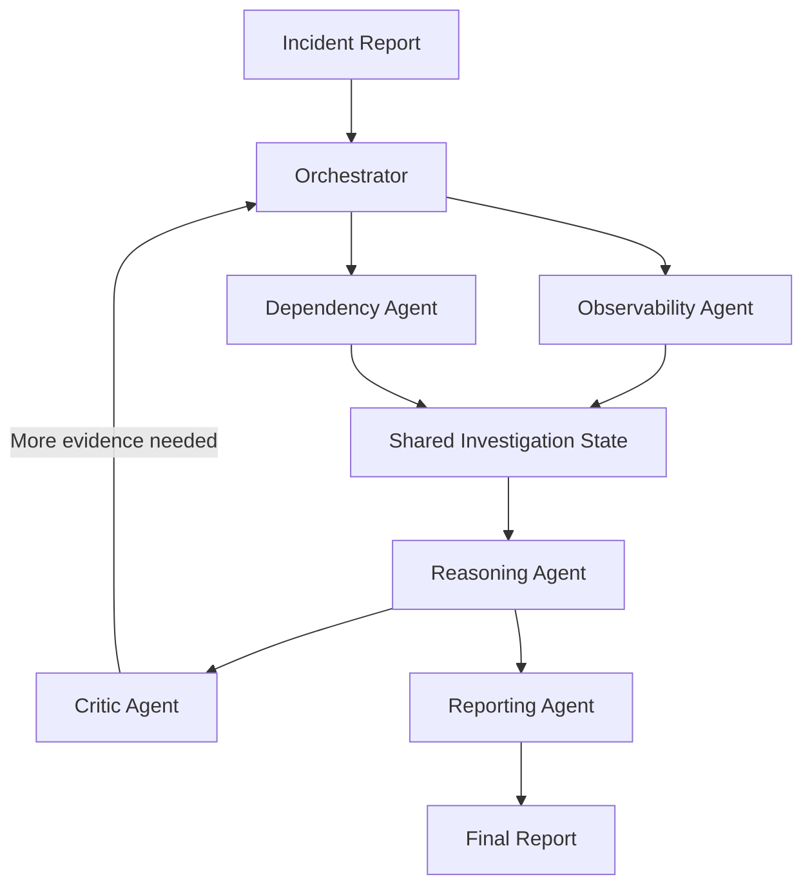

# Orange Invest Assignment FE

This project implements a multi-agent production incident investigation system and evaluates it against a single-agent baseline.

## Quick start

```bash
python -m venv .venv
. .venv\Scripts\activate
python -m pip install -e ".[dev]"
python -m pytest
python -m orange_incident_investigation.main --demo
```

## What is delivered

- Runnable multi-agent investigation implementation
- Synthetic incident dataset with 10 scenarios
- Automated evaluation comparing multi-agent vs. single-agent baseline
- Architecture diagram and technical note
- Setup instructions and notes on incomplete functionality

## Project structure

- `src/orange_incident_investigation/`: implementation
- `tests/`: test suite
- `data/`: generated dataset artifacts

## Architecture



The orchestrator owns a shared state object containing evidence, task results, and pending follow-ups. Independent tasks (logs, metrics, config checks) execute in parallel, while the reasoning and critic agents operate on the accumulated evidence and drive iterative feedback loops. This produces a more evidence-grounded final outcome than a single pass with one model call.

## Running the demo

```bash
python -m orange_incident_investigation.main --demo
```

This runs a sample incident with the multi-agent pipeline and prints a structured report.

## Lightweight web interface

```bash
python -m orange_incident_investigation.main --web
```

Open `http://127.0.0.1:8000` in a browser, select one of the synthetic incidents, and click **Investigate** to view ranked hypotheses, evidence, confidence, and recommended actions. The interface and HTTP API use only the Python standard library and bind to localhost by default.

## Evaluation

```bash
python -m orange_incident_investigation.main --evaluate
```

This runs both the multi-agent system and the single-agent baseline across the 10 included synthetic incidents, writes `data/evaluation_results.json`, and prints a comparison table with metrics for root-cause accuracy, evidence grounding, tool call count, latency, and estimated token consumption.

## Technical note

The design uses a shared evidence graph instead of a single prompt-controlled chain. The orchestrator decomposes an incident into parallel investigation tracks: observability and dependency analysis. Each agent speaks in structured output objects so the reasoning agent can compare competing hypotheses against concrete evidence rather than inferred narrative summaries. This mitigates hallucinated conclusions and allows contradictions to be exposed explicitly.

The primary trade-off is complexity and orchestration overhead. The multi-agent design adds coordination and state management costs, so it usually makes more tool calls and takes longer than a single-agent pass. However, it is more robust under ambiguous or contradictory data because the critic agent can request more evidence and the reasoning agent can rank hypotheses by support and contradiction.

The system does not call or require an LLM. Its agents are deterministic Python components that use simple text matching and evidence scoring; this makes the demo reproducible but is not equivalent to production-grade language-model reasoning. Evaluation ground truth is used only to calculate accuracy, never to rank hypotheses. The simulation intentionally includes timeout, incomplete, and misleading evidence cases to test resilience and evidence discipline.

## Assistant transcript

The AI coding assistant was used to implement the assignment and validate the project. A concise transcript is included in `docs/assistant_transcript.txt`.

## Notes

- The implementation includes a single-agent baseline for comparison.
- The web interface investigates the included synthetic incidents; it is not connected to live production telemetry.
- Incomplete functionality and external dependencies are documented here.
- The current reasoning is deterministic and lexical rather than LLM-powered.
