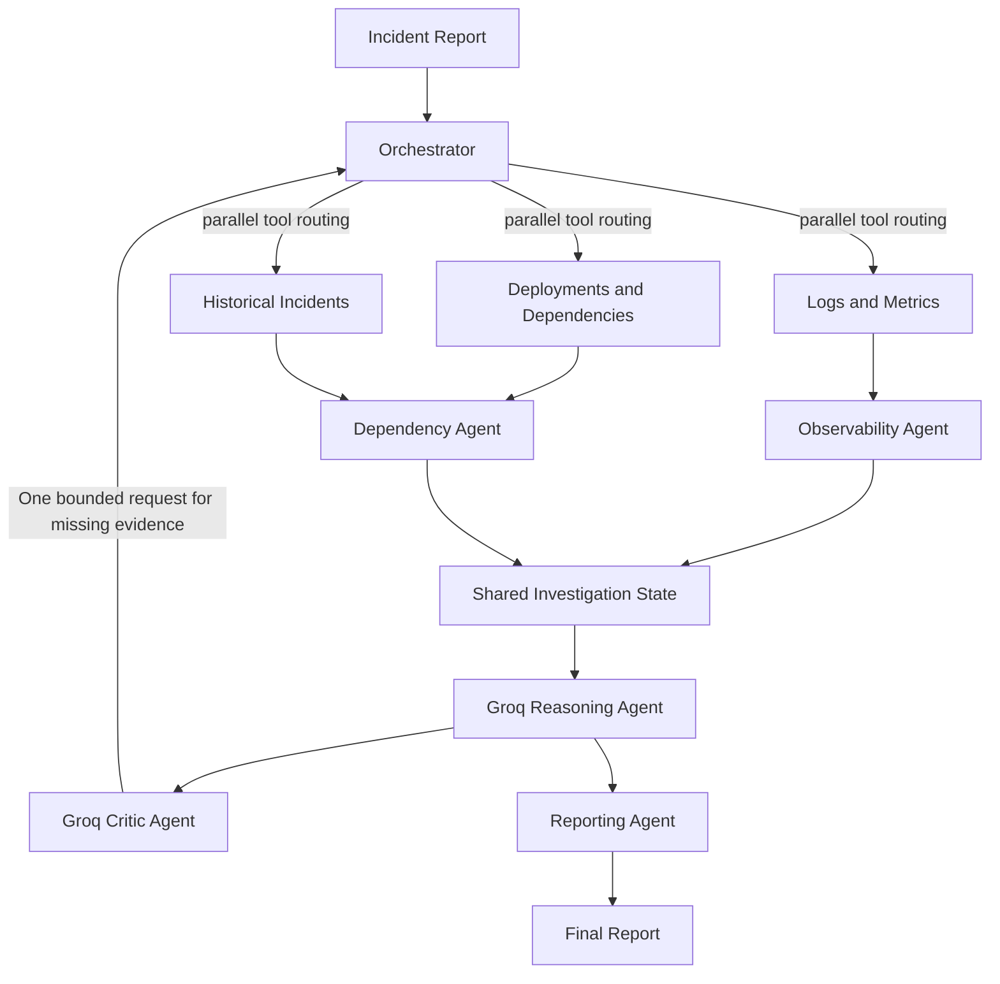

# Orange Invest Assignment FE

This project implements a multi-agent production incident investigation system and evaluates it against a single-agent baseline.

## Quick start

Run these commands from the project root, `C:\Users\hp\OneDrive - Lovely Professional University\Desktop\Orange`
(the directory containing `pyproject.toml`), not from inside `src`.

```bash
python -m venv .venv
. .venv\Scripts\activate
python -m pip install -e ".[dev]"
if (!(Test-Path .env)) { Copy-Item .env.example .env }
# Edit .env and set GROQ_API_KEY to your own key
python -m pytest
python -m orange_incident_investigation.main --demo
```

If Groq rejects the key/model with HTTP 403, run the demo without the LLM while you check account
access:

```powershell
python -m orange_incident_investigation.main --demo --offline
```

Add `--offline` to `--evaluate` or `--web` as well to force the deterministic fallback for those modes.

The repository includes a blank, ignored `.env` placeholder and a safe `.env.example`. Paste your
Groq API key into the local `.env` file only; never commit it or share it in chat. The project-local
`.env` controls the key so an unrelated process-level key is not used accidentally. `GROQ_MODEL`
defaults to `openai/gpt-oss-120b` and can be changed in `.env`. With a valid key configured,
investigation and evaluation make real Groq API requests and may incur account usage. Without a key,
the app clearly reports that it is using its local deterministic evidence-based fallback.

If Groq returns HTTP 403, verify the key is valid, the account has API access, and the selected model
is available to that account. HTTP 401 usually means the key is invalid or expired; HTTP 404 usually
means the model ID is unavailable. The CLI prints a short actionable error without a traceback, and
provider error text is sanitized so it cannot echo the configured key.

## What is delivered

- Runnable multi-agent investigation implementation
- Synthetic incident dataset with 10 scenarios
- Automated evaluation comparing multi-agent vs. single-agent baseline
- Architecture diagram and technical note
- Setup instructions and notes on incomplete functionality

## Project structure

- `src/orange_incident_investigation/`: implementation
- `tests/`: test suite
- `data/`: generated dataset artifacts

## Architecture



The Groq-backed orchestrator first routes the incident to relevant independent evidence tools. Observability and dependency agents turn returned logs, metrics, deployments, dependencies, and historical incidents into structured evidence in shared state. A Groq reasoning call proposes ranked hypotheses with evidence citations; the critic checks the proposal and can route one bounded follow-up pass to tools not yet queried. The reporting agent emits the structured report. All model outputs are parsed and evidence citations must match supplied evidence verbatim. Without a key, a local evidence-derived fallback is used.

## Running the demo

```bash
python -m orange_incident_investigation.main --demo
```

This runs a sample incident with the multi-agent pipeline and prints a structured report.

## Lightweight web interface

```bash
python -m orange_incident_investigation.main --web
```

Open `http://127.0.0.1:8000` in a browser, select one of the synthetic incidents, and click **Investigate** to view ranked hypotheses, evidence, confidence, and recommended actions. The interface and HTTP API use only the Python standard library and bind to localhost by default.

## Evaluation

```bash
python -m orange_incident_investigation.main --evaluate
```

This runs both the multi-agent system and the single-agent baseline across the 10 included synthetic incidents, writes `data/evaluation_results.json`, and prints a comparison table with metrics for root-cause accuracy, exact evidence-citation grounding, tool call count, latency, and token consumption reported by Groq (zero when running without an LLM).

## Technical note

The design uses shared investigation state instead of a single prompt-controlled chain. The Groq orchestrator routes independent tool queries in parallel, and the critic can ask for one bounded follow-up pass. Structured evidence is passed to the Groq reasoning call, and verbatim evidence validation rejects unsupported citations. The single-agent baseline uses the same tools and model for one evidence synthesis call, without orchestration or critic routing.

The primary trade-off is additional API latency and token cost for orchestration and criticism. The baseline makes one synthesis call while the multi-agent path may make planner, reasoner, and critic calls. Evaluation records actual token usage returned by Groq; when no key is set, token counts are zero and results describe the deterministic fallback rather than LLM performance.

The system uses Groq's OpenAI-compatible chat-completions API when configured; its model name is set through `GROQ_MODEL`. It can still run offline with a deterministic evidence-derived fallback. Synthetic ground-truth labels are used only for evaluation and are never sent to agents. This is a simulation, not connected to live telemetry; the small synthetic evaluation does not establish production accuracy. Real deployments would need authentication, audit controls, prompt-injection defenses, stronger observability connectors, and human approval for remediation.

## Assistant transcript

The AI coding assistant was used to implement the assignment and validate the project. A concise transcript is included in `docs/assistant_transcript.txt`.

## Notes

- The implementation includes a single-agent baseline for comparison.
- The web interface investigates the included synthetic incidents; it is not connected to live production telemetry.
- LLM mode needs internet access and a valid Groq API key in `.env`; the Python client uses the standard library plus `python-dotenv`.
- Incomplete functionality and external dependencies are documented here.
- Groq API access and a valid key are required for LLM-powered runs; the fallback is not LLM-powered.
- The evaluation dataset's expected root causes are stored solely as scoring labels, not as candidate answers available to investigators.
